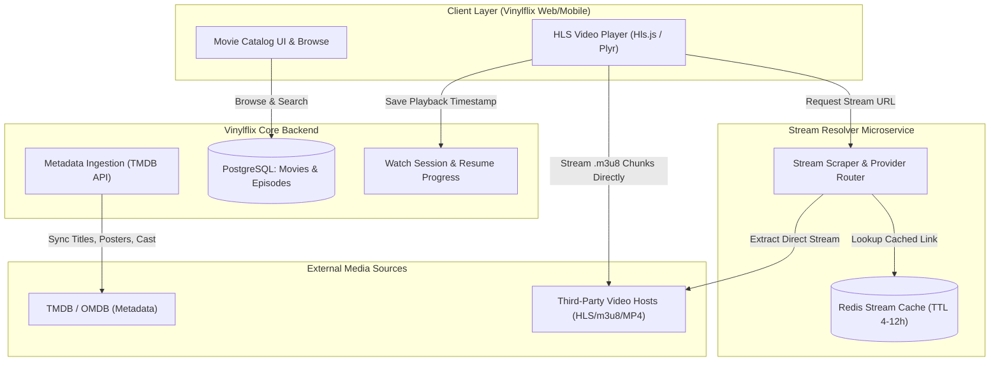

# Future Feature Proposal: Movie Aggregation & Streaming Engine for Vinylflix

## 1. Executive Summary

This document outlines the proposed architecture and implementation roadmap for introducing a **Full-Length Movie & Series Streaming Catalog** to **Vinylflix**.

Currently, Vinylflix is optimized for campaign-backed, short-form/promotional video content (such as YouTube-based embeds and TikTok-style vertical reels with gamified watch rewards). By integrating an aggregated movie catalog, Vinylflix can evolve into an all-in-one entertainment hub, giving users access to high-demand feature films and series without burdening your infrastructure with massive video storage and petabyte-scale bandwidth costs.

---

## 2. High-Level Architecture

The streaming feature relies on a **three-tier decoupled model**:



---

## 3. Core Functional Components

### A. Metadata & Catalog Indexing (TMDB / OMDB)
Rather than manually scraping metadata or uploading movie assets:
- **API Integration**: Integrate with **The Movie Database (TMDB)** API for legal, rich, and high-quality metadata.
- **Data Ingested**:
  - Titles, Synopses, Taglines, Genres
  - High-res posters, backdrops, and promotional banners
  - Cast, Director, Release Year, Age Ratings, IMDb/TMDB scores
  - Season/Episode hierarchies for TV shows
- **Automated Sync Worker**: A background cron worker that periodically fetches trending, top-rated, and newly released titles into the Vinylflix database.

### B. Stream Extraction & Link Resolution Layer
To keep server load minimal and decouple extraction logic from Vinylflix core:
- **Dedicated Microservice/Worker**: Run a specialized extractor service (Node.js or Python) responsible for taking an IMDb/TMDB ID and resolving working stream sources.
- **Extraction Techniques**:
  - **Headless automation**: Uses lightweight headless scrapers (Playwright/Puppeteer) or reverse-engineered provider APIs.
  - **Cloudflare Bypass**: FlareSolverr or residential proxy rotation if dealing with protected hosts.
  - **HLS (.m3u8) Stream Extraction**: Extracts the direct adaptive master playlist (`master.m3u8`) which provides 1080p, 720p, 480p streams and multiple audio tracks.
- **Short-Lived Caching**: Video links frequently expire or rotate tokens every 4 to 24 hours. The resolver caches resolved URLs in Redis with a short TTL (e.g., 3–6 hours) to prevent repeated scraping overhead.

### C. Frontend Player & Playback Experience
- **Player Upgrade**: Replace or extend the standard YouTube player with a versatile HLS-compatible HTML5 player (such as **Video.js**, **Plyr**, or **Hls.js** directly).
- **Features to Support**:
  - **Adaptive Bitrate Streaming (ABR)**: Automatically scales between 360p, 720p, and 1080p based on user network speed.
  - **Subtitle / Closed Captions Engine**: Loads external WebVTT (`.vtt`) subtitle files (sourced via OpenSubtitles API or scraped alongside video).
  - **Resume Playback**: Saves `currentPositionSeconds` continuously so users can resume where they left off across devices.
  - **Fullscreen, Theater Mode & Picture-in-Picture (PiP)**.

### D. Watch Sessions & Campaign Synergy
- **Non-Campaign vs Campaign Separation**:
  - General movie watching will not flood the system with campaign reward heartbeats (as established in our recent fix).
  - Instead, lightweight progress updates are saved periodically (e.g., every 30–60 seconds) strictly for the "Continue Watching" row.
- **Sponsored Movies / Ad Insertion (Optional)**:
  - You can gate certain premium movie titles behind campaign activities (e.g., "Watch 1 sponsored campaign video to unlock 3 movie passes").

---

## 4. Database Schema Extensions (Prisma Draft)

```prisma
enum ContentType {
  MOVIE
  SERIES
  EPISODE
}

model MediaTitle {
  id              String         @id @default(uuid())
  tmdbId          Int?           @unique
  imdbId          String?        @unique
  title           String
  originalTitle   String?
  overview        String?        @db.Text
  releaseDate     DateTime?
  posterUrl       String?
  backdropUrl     String?
  runtimeMinutes  Int?
  type            ContentType    @default(MOVIE)
  genres          String[]       @default([])
  rating          Decimal?       @db.Decimal(3, 1) // e.g. 8.4
  popularityScore Decimal?       @db.Decimal(8, 2)
  isFeatured      Boolean        @default(false)
  createdAt       DateTime       @default(now())
  updatedAt       DateTime       @updatedAt

  episodes        MediaEpisode[]
  watchHistory    UserWatchHistory[]
}

model MediaEpisode {
  id              String         @id @default(uuid())
  titleId         String
  mediaTitle      MediaTitle     @relation(fields: [titleId], references: [id], onDelete: Cascade)
  seasonNumber    Int
  episodeNumber   Int
  name            String
  overview        String?        @db.Text
  stillUrl        String?
  runtimeMinutes  Int?

  createdAt       DateTime       @default(now())
  watchHistory    UserWatchHistory[]

  @@unique([titleId, seasonNumber, episodeNumber])
}

model UserWatchHistory {
  id              String         @id @default(uuid())
  userId          String
  user            User           @relation(fields: [userId], references: [id], onDelete: Cascade)
  mediaTitleId    String
  mediaTitle      MediaTitle     @relation(fields: [mediaTitleId], references: [id], onDelete: Cascade)
  episodeId       String?
  episode         MediaEpisode?  @relation(fields: [episodeId], references: [id], onDelete: SetNull)
  lastPositionSec Int            @default(0)
  totalDurationSec Int           @default(0)
  isCompleted     Boolean        @default(false)
  updatedAt       DateTime       @updatedAt

  @@unique([userId, mediaTitleId, episodeId])
}
```

---

## 5. Phased Roadmap

| Phase | Milestone | Deliverables |
| :--- | :--- | :--- |
| **Phase 1** | **Metadata Ingestion & UI** | TMDB API client, Media database models, Netflix/Vinylflix-style movie catalog browser (Hero slider, genre carousels, movie details modal). |
| **Phase 2** | **Player & Subtitle Engine** | HLS-ready modern HTML5 video player component (`HlsVideoPlayer.tsx`), subtitle track loader, speed controls, and responsive controls. |
| **Phase 3** | **Stream Resolver Service** | Dedicated extractor/resolver microservice with Redis caching for stream links and multi-provider fallback. |
| **Phase 4** | **Watch Progress & Retention** | "Continue Watching" shelf, user watchlists, viewing history page, and integration with Vinylflix membership tiers. |

---

## 6. Key Considerations

1. **Bandwidth & Hosting Cost**: By relaying streams from external third-party hosts or embeds, Vinylflix pays \$0 for video CDN bandwidth and \$0 for petabyte storage.
2. **Provider Rotations**: Free external streaming links can go down frequently; building a multi-provider fallback list ensures high availability.
3. **Legal Compliance**: Review local copyright regulations and platform terms regarding embedding and aggregation.
